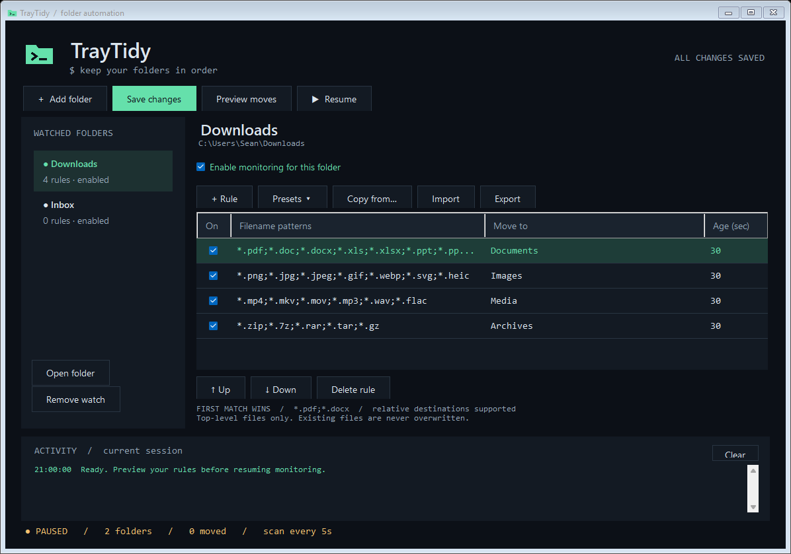

# TrayTidy

[](https://github.com/SeanShaffer88/TrayTidy/actions/workflows/build.yml)
[](https://github.com/SeanShaffer88/TrayTidy/releases/latest)
[](LICENSE)

A small Windows tray utility for organizing multiple folders with independent, ordered rules. The terminal-inspired editor helps you define, preview, and reuse rules. No account, network connection, or third-party runtime packages are required.



## Download

| Download | Use it when |
| --- | --- |
| [Portable ZIP](https://github.com/SeanShaffer88/TrayTidy/releases/latest/download/TrayTidy-0.3.0-Portable.zip) | Extract and run, with settings beside the executable. |
| [Windows installer](https://github.com/SeanShaffer88/TrayTidy/releases/latest/download/TrayTidy-0.3.0-Setup.exe) | Per-user installation, Start menu entry, and uninstaller. |
| [SHA-256 checksums](https://github.com/SeanShaffer88/TrayTidy/releases/latest/download/SHA256SUMS.txt) | Verify downloaded files against the release. |

Requires **Windows 10/11 and .NET Framework 4.8 or later**. Tested on Windows x64; other architectures are unverified. Binaries are unsigned.

**Portable:** extract the entire ZIP to a writable folder and run `TrayTidy.exe`. Keep `portable.flag` beside it; settings and backups live in `data/`. Moving the folder moves those settings, although absolute watched paths still need to exist on the destination computer.

**Installer:** run Setup. It installs to `%LOCALAPPDATA%\Programs\TrayTidy` without requesting administrator access. Desktop and sign-in shortcuts are optional and off by default. Uninstall through Windows Settings → Apps. Your rules and settings are preserved. Exit any running TrayTidy before installing, updating, or uninstalling.

To migrate between editions, exit the app and copy `settings.json` between the portable `data/` folder and `%LOCALAPPDATA%\TrayTidy`. Only one edition can run at a time in the same user session.

## Start

1. Run `TrayTidy.exe`.
2. Choose **Add folder** for each folder to organize.
3. Click **+ Rule** to add rows, or choose **Presets** for documents, images, media, archives, or all four. Patterns accept `*` and `?`; separate alternatives with semicolons, for example `*.pdf;*.docx`. Matching ignores case.
4. Enter a destination such as `Documents` (relative to that watched folder), or an absolute path. Set the minimum age in seconds.
5. **Save changes**, then **Preview** to inspect eligible moves across all enabled folders.
6. Click **Resume** to begin automatic organization. **Pause** stops subsequent moves; a move already in progress may finish.

The first matching enabled rule wins. A matching rule that is waiting for its minimum age prevents lower rules from taking the file. Reorder with **Move rule up/down**. Uncheck a rule or folder to disable it. Rules affect files only, and each watched folder is scanned at its top level every five seconds. Subfolders are never traversed.

To reuse a ruleset, select the destination folder, click **Copy rules from…**, choose a source folder, then click **Replace selected folder's rules**. This replaces the selected folder's rules with an independent copy; changing one folder afterward does not change the other. Relative destinations adapt to each folder. Absolute destinations continue pointing to the same absolute location. Save the result.

Closing the window keeps TrayTidy running in the notification area (Windows may put the icon under the hidden-icons arrow). Double-click the icon to reopen; right-click for pause/resume or **Exit**. One instance runs per Windows user session. Startup at sign-in is off by default. Enable the optional installer task or put a shortcut in the Windows Startup folder (`Win+R`, `shell:startup`).

## Terminal-inspired interface

Charcoal surfaces, mint accents, and monospace text give the editor a terminal-inspired appearance. The folder sidebar shows each folder's rule count and enabled state. The footer shows monitoring state, files moved this session, and the last scan time. An unsaved-changes indicator and Ctrl+S shortcut help keep edits clear.

**Import** replaces the selected folder's rules from a JSON ruleset; **Export** saves its current rules for reuse or backup. Imported rules are validated before replacing the editor contents. Presets append rules, so move them above an existing catch-all rule if needed. **Open folder** opens the selected folder in Explorer. **Clear** empties the session activity display.

The custom folder/prompt icon is embedded in the executable, window, and tray. `TrayTidy.ico` includes 16, 20, 24, 32, 40, 48, 64, 128, and 256 pixel sizes; `TrayTidy-icon.png` is its transparent master. `IconBuild.cs` and `build-icon.ps1` reproduce the assets without external packages.

Pausing preserves unfinished edits without saving them. Resuming validates and saves current rules. Monitoring status may differ from a folder's enabled checkbox: a folder only runs when both it and global monitoring are enabled.

## File handling and limits

- Existing destination files are preserved. Collisions become `name (1).ext`, `name (2).ext`, etc.
- Files must be at least five seconds old, or the configured age if larger. `.part`, `.crdownload`, `.tmp`, and `.download` files are ignored.
- Locked or changing files are deferred and retried on later scans. A writer that closes and later reopens a file can still race the move; choose a longer age for slow downloads or exports.
- Folder links and linked files are skipped; destination directory links are rejected. Watched folders cannot overlap, and destinations cannot equal any watched root.
- Scans include existing files, including files added while the app was closed. Paused monitoring is persisted across restarts.
- Only saved rules run. Preview saves the current edits before inspecting them. New installations start paused.
- Files are moved, with no undo history. Preview is a point-in-time plan; collision suffixes are selected during the actual move. Network availability, permissions, and external file changes can prevent moves.
- Activity and errors appear in the settings window; this log is kept in memory. Missing folders are retried silently. Large folders may take longer than five seconds to scan; scans never overlap.

Installed settings live at `%LOCALAPPDATA%\TrayTidy\settings.json`; portable settings live at `data/settings.json` beside the executable. The previous saved version is retained as `settings.json.bak`. Invalid settings cause startup to stop without overwriting them. Exit before restoring a backup. Settings paths and rule contents stay local.

## Build and validation

The app uses C# and Windows Forms with the Windows-supplied .NET Framework compiler. Build tools stay separate from the runtime payload.

```powershell
.\build.ps1
.\test.ps1
# Install or extract Inno Setup 6.7.3 separately, then:
.\package.ps1 -IsccPath 'C:\Tools\Inno Setup 6\ISCC.exe'
.\verify-package.ps1
```

`package.ps1` builds and tests, stages clean runtime files, creates both downloads under `dist/`, and writes `SHA256SUMS.txt`. It requires [Inno Setup](https://jrsoftware.org/isinfo.php), whose attribution and license appear in [third-party notices](THIRD-PARTY-NOTICES.md). Repository CI pins the compiler download by SHA-256 and verifies its Authenticode signature. Packaging verification exercises installation and uninstall registration; use a clean Windows user profile without another installed/running TrayTidy.

25 application checks cover matching, ordering, age, partial and nested files, collisions, locked-file retry, disabled folders/rules, independent copies, invalid configurations, settings serialization, presets, embedded icons, the terminal palette, a two-folder background scan, pause behavior, and portable/installed settings paths. Package checks cover checksums, payload contents, portable startup, per-user install, matching executables, installed startup in an isolated configuration, and uninstall cleanup. Tests never organize the user's folders. UI layouts have been rendered and visually reviewed at default and minimum sizes on Windows x64.

To verify a download, compare `Get-FileHash .\TrayTidy-0.3.0-Portable.zip -Algorithm SHA256` with `SHA256SUMS.txt` from the same release. Checksums detect corruption; they do not replace publisher code signing.

Implementation uses the built-in .NET Framework APIs, avoiding new runtime downloads and third-party licenses. Periodic scans were selected for simplicity and recovery from app downtime; Microsoft's [FileSystemWatcher documentation](https://learn.microsoft.com/en-us/dotnet/api/system.io.filesystemwatcher) describes event duplication and buffer overflow considerations for event-based monitoring.

See [CHANGELOG](CHANGELOG.md), [contributing](CONTRIBUTING.md), and [security reporting](SECURITY.md). Report bugs or request features through [Issues](https://github.com/SeanShaffer88/TrayTidy/issues). Licensed under [MIT](LICENSE).
